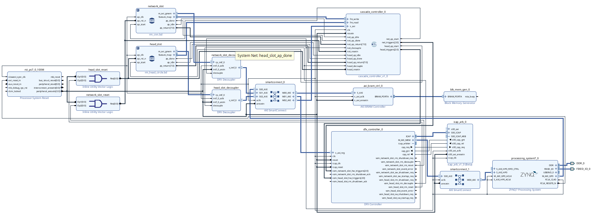
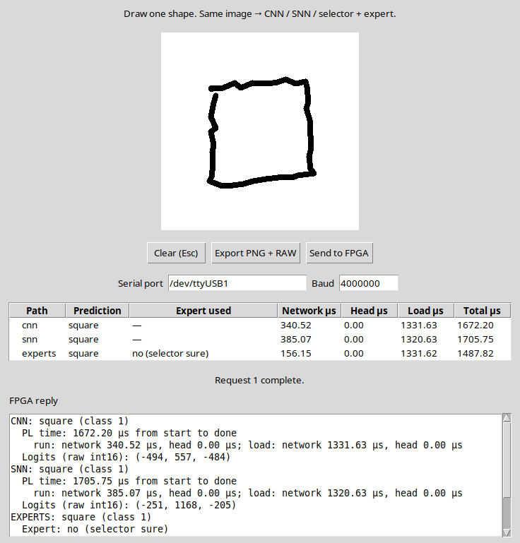

# Circle, square or triangle on an FPGA

Draw a shape on the PC and three neural networks tell you what it is, running on the programmable logic of a PYNQ-Z2 (Zynq xc7z020, 100 MHz). The same 70 x 70 image goes over UART to the board and is classified three ways:

* a **CNN**,
* a fully spiking network (**SNN**) with leaky integrate-and-fire neurons in every layer and six time steps,
* a **cascade**: a small selector network drops the least likely class and one of three head networks decides between the other two.

The six networks do not fit in the fabric at the same time, and they do not have to. They are swapped in and out by partial reconfiguration through the ICAP, and a controller written in VHDL does the loading, starting and result handling on its own once the PS has started it. The PS only moves the image in and the answers out.

## What it can do

* **Classify a hand-drawn shape in well under a millisecond:** CNN 340.5 µs, SNN 385.1 µs, cascade 156.2 µs when the selector is sure. Accuracy on the board over 5,517 hand-drawn test images is 98.11% (CNN), 97.14% (SNN) and 98.28% (cascade).
* **Run a truly spiking network in hardware:** every layer spikes, only spikes pass between layers, and each weight read updates all six time steps at once.
* **Skip work when it can:** the selector knows when it is confident, and then the head is neither loaded nor run. This happens for 43% of the images and the cascade keeps its accuracy.
* **Swap a network in 0.8 to 1.3 ms:** a head takes 0.78 ms and a network 1.33 ms to load through the ICAP, using compressed partial bitstreams.
* **Fit in a small part of the chip:** one network at a time takes 22.7% (CNN), 26.1% (SNN) or 27.9% (cascade) of the LUTs, static design included.
* **Show it live:** draw in `pc/draw.py` and see the answer, load time and run time of all three paths.



## How a request flows

```
PC (draw.py)  --- UART, 4 Mbaud, 4,904 bytes --->  PS (helloworld.c)  --- image in BRAM --->  cascade controller (VHDL)
                                                                                                  |  DFX Controller + ICAP loads
                                                                                                  v
PC (draw.py)  <-- UART, 90 bytes ----------------  PS (helloworld.c)  <-- class, scores, cycle counters ---  network slot: CNN | SNN | selector
                                                                                                         head slot: circle | square | triangle head
```

1. The PC scales the drawing to 70 x 70 grayscale and sends it as one frame.
2. The PS stores the image in the BRAM and starts the controller, once for each path (CNN, SNN, cascade).
3. The controller loads the network into its slot if the slot holds another one, runs it, and for the cascade lets the selector choose the head.
4. The PS reads the class, the scores and the cycle counters and sends one 90-byte reply with a record per path.

## Results

Measured on the board with 5,517 hand-drawn test images:

| | CNN | SNN | Cascade |
|---|---:|---:|---:|
| accuracy on the FPGA | 98.11% | 97.14% | 98.28% |
| inference time (PL) | 340.5 µs | 385.1 µs | 156.2 µs (head skipped), 204.7 µs (head already loaded), 987 µs (head reloaded) |
| LUTs of the xc7z020, incl. static design | 22.7% | 26.1% | 27.9% (with the triangle head, the largest) |

Cascade mean in dataset order: 279.3 µs, including the head reloads; the head is skipped for 43% of the images. Loading a network into the network slot adds 1.3 ms and a head 0.78 ms, so the cascade is slower than the CNN when heads are reloaded often.
The CNN and the SNN answer exactly like their integer reference on all images.

### UART and what comes next
The UART transfer is reported separately from the inference time: one request takes 22.7 ms in all, of which 5.2 ms is PS/PC software time not shown in the [time per request](graphs/8_time_per_request_uart_overhead.pdf) figure. The image frame alone needs 12.3 ms at 4 Mbaud (4,904 bytes, 10 bits each), so the transfer takes more than the inference.

Figures in `graphs/`: [training curves](graphs/1_training_curves.pdf), [errors of all models](graphs/2d_errors_all_models.pdf), [confusion matrices](graphs/3_confusion_matrices.pdf), [resource usage](graphs/4_resource_usage_cnn_snn_cascade.pdf), [UART frame layout](graphs/5_uart_frame_layout.pdf), [cascade outcomes](graphs/6_cascade_outcomes.pdf), [accuracy on hardware](graphs/7_accuracy_on_hardware.pdf), [time per request](graphs/8_time_per_request_uart_overhead.pdf), [power estimate](graphs/11_power_estimate_per_configuration.pdf), [training examples](graphs/12_training_examples.pdf).



## Setup

```bash
python3 -m venv .venv && source .venv/bin/activate
python -m pip install -r requirements.txt     # the PC app also needs Tk (python3-tk)
python pc/draw.py --port /dev/ttyUSB1         # PC app, 4 Mbaud
python data/data_generator.py                 # only to regenerate data/shapes_dataset
cd train_model && python train_cnn.py         # and the other training scripts below
```

## Data

### Handwritten data (**data/shapes/**)
The handwritten 70 x 70 grayscale PNGs, one folder per class (`circle`, `square`, `triangle`). The second field of each filename is the contributor; the training/validation/test split is by contributor (listed in `train_model/augment_data.py`), so no person appears in two splits. The contributors not listed there are the held-out test set, which is used only for the final results.

### Synthetic data (**data/data_generator.py**, **data/shapes_dataset/**)
Draws squares, circles and triangles with a hand-drawn look (rotation, size, position, line thickness, wobble, blur, noise) into 70 x 70 grayscale PNGs with a 60 / 20 / 20 train / validation / test split (40,000 images per class by default; the committed dataset is exactly the images listed in `labels.csv`, with no duplicates across the splits). The training scripts need at least 3,000 validation images per class. Every setting is a constant at the top of the file. `labels.csv` lists the parameters of each image. Its numeric labels (`class_mapping.txt`: square 0, circle 1, triangle 2) are not used; training takes the class from the folder name (circle 0, square 1, triangle 2, the order of the networks' outputs).

## Training (**train_model/**)

All scripts read the settings from the block at the top (`EDIT THESE`) and write to `train_model/runs/`. PyTorch uses CUDA when available. The two bundled checkpoints in `checkpoints/` are the CNN teacher (knowledge distillation target for all networks) and the selector used for standalone head training.

### Data augmentation (**augment_data.py**)
Holds the class order, the contributor split of the handwritten data, and the augmentation (rotation, flip, scale, shift, thicker or thinner strokes, noise) applied to every training batch. Run alone it saves a few original and augmented examples to `runs/augmentation/` for inspection.

### Shared training code (**train_common.py**)
Loads both corpora (handwritten and synthetic), samples batches (70% handwritten), the distillation loss, the training loop with a moving-average model and validation, and the checkpoint files (weights, validation logits, metrics).

### CNN (**train_cnn.py**)
Trains the standalone CNN: stride-4 5 x 5 stem, depthwise and pointwise convolutions, one hidden layer, three outputs.

### SNN (**train_snn.py**)
Trains the fully spiking network with quantisation in the forward pass: leaky integrate-and-fire neurons in every layer, six time steps, the inverted image as a constant input current, surrogate gradient for the spikes. The last layer integrates and fires without leak.

### Selector and heads (**train_selector.py**, **train_head.py**)
`train_selector.py` trains the selector and the three heads together. The selector is trained only so that the true class is never ranked last; it passes its 8 x 8 x 10 feature map to the head of the two remaining classes. Each head is named after the class the selector excludes. `train_head.py` trains heads on a frozen selector (default: the bundled one).

### HLS export (**export_hls.py**, **integer_reference.py**)
`python export_hls.py cnn|snn|selector|head --checkpoint DIR [--out DIR]` turns a trained checkpoint (the `model.pt` or `head.pt` folder written by the training scripts) into the two headers the HLS network includes: `nn_weights.h` (folded, quantised weights and biases in the lane-banked ROM layout) and `nn_calibration.h` (30 handwritten validation images, for the SNN 9 synthetic ones too, plus an all-white, an all-black and a noise image, each with the expected scores). A head also needs its selector (`--selector`, or the `selector` entry in its `metrics.json`). Example: `python export_hls.py selector --checkpoint checkpoints/selector`. Without `--out` the files go to `runs/export/<network>/` (`head_circle` etc. for the heads).
`integer_reference.py` is the bit-exact integer model (BatchNorm folding, weight quantisation, requantisation shifts, the integer LIF network) that produces the expected scores. The bit widths, shifts and layer sizes are fixed by the `nn.cpp` of each network, so the exporter writes only the two headers (to `train_model/runs/export/<network>/`, never into `Vitis/`) and leaves `nn.cpp` alone. Run on the bundled selector it reproduces the committed `nn_weights.h` of `NN_selector` exactly; run on the checkpoints behind the other delivered networks (not part of this repository) it reproduces theirs too. A newly trained network gives new weights and needs its own HLS build.

## HLS networks (**Vitis/**)

Six Vitis HLS modules, one folder each: `CNN_standalone`, `SNN_standalone`, `NN_selector` and the heads `NN_circle`, `NN_square`, `NN_triangle` (named after the class the selector excludes). Every folder holds the same four files:

* **nn.cpp** – all of the code of the network, integer arithmetic only. One `run_layer` function runs every layer from a layer table on six lanes. The sizes, bit widths, requantisation shifts and ROM layout that come from the trained model are in the **NETWORK CONFIGURATION** block at the top. Top-level function `shape_accel`: `ap_ctrl_hs` and a returned class result. The CNN, the SNN and the selector read the image and write their scores over an AXI master at fixed addresses in the BRAM; the selector also writes the feature map to a BRAM port, which the heads read instead of an image (they write their score over the AXI master).
* **nn_weights.h** – the weight and bias tables, nothing else (generated).
* **nn_calibration.h** – test vectors: real held-out validation images (run-length encoded), an all-white, an all-black and a noise image, with the expected Q16.16 scores (generated).
* **nn_tb.cpp** – testbench for C simulation and RTL co-simulation: runs the vectors and compares the scores bit-exactly. `TEST_VECTOR_LIMIT=N` runs a subset of N vectors (N must not exceed the number of vectors).

| Folder | Network | Placed in its slot (LUT / FF / BRAM tiles / DSP) | Time on the board |
|---|---|---|---|
| `CNN_standalone` | stride-4 stem, depthwise + pointwise ×2, hidden, output; the highest score is the class | 3,684 / 2,828 / 8.5 / 8 | 340.5 µs |
| `SNN_standalone` | fully spiking, 6 time steps: 9 × 9 stride-6 stem, depthwise, pointwise, 96 hidden, 3 output neurons; the weights are in LUT ROM | 5,493 / 3,568 / 2.5 / 12 | 385.1 µs |
| `NN_selector` | image → 3 scores and the feature map; the lowest score is the excluded class | 3,546 / 3,105 / 5.5 / 8 | 156.2 µs |
| `NN_circle`, `NN_square`, `NN_triangle` | feature map → 1 score, ≥ 0 picks the first class of the pair (circle excluded: square; square excluded: circle; triangle excluded: circle) | 2,885 / 1,935 / 3 / 7 (circle) | 48.6 µs |

Inputs and outputs: the image is `image_gray8` (4,900 bytes packed little-endian in 1,225 words), the scores are `scores_q16` (Q16.16). The SNN gets the inverted image as a constant input current (direct coding) for six time steps. The selector returns the excluded class (bits 1:0), its top-1 class (bits 3:2) and a confident bit (bit 4, best score beats the second best by 13.1); when it is set, the head is skipped.
The six modules are alternatives, not six accelerators at the same time: the CNN, the SNN and the selector take turns in the network slot, the three heads in the head slot. The resource counts must not be summed.
Accuracy on the hand-drawn test set (held out by contributor): CNN 98.13% (integer 98.11%), SNN 97.14%, cascade 98.28%; synthetic test: 99.77%, 99.42%, 99.64%.

## Hardware (**dfx/**)

### Cascade controller (**hdl/cascade_controller.vhd**, **hdl/slot_runner.vhd**)
Once the PS has started it, this VHDL controller runs everything in the PL: it loads a network into its slot through the DFX Controller (hardware trigger *i* loads module *i*) if the slot holds another one, starts it (`ap_start`), waits for `ap_done`, and for the cascade uses the selector's result to load and run the right head (unless the selector is confident). It also holds the 640 × 16 bit feature-map RAM between the selector and the head, so the map survives the rewrite of the head slot.
`slot_runner.vhd` is the state machine of one slot (load, wait idle, start, wait done; 100 ms timeout); the controller sequences the two slots.
Registers (AXI4-Lite, 0x40030000): `CONTROL` (bit 0 start, bits 2:1 mode: 0 CNN, 1 SNN, 2 cascade), `STATUS` (busy, done, error, module in each slot), `RESULT` (final class, excluded class, head skipped, head ran) and five cycle counters of the last run (network load / run, head load / run, total; 10 ns per count).

### Interface helper (**hdl/bram_master_tieoff.vhd**) and testbench (**hdl/tb_cascade_controller.vhd**)
The CNN and the SNN have no feature-map port, but all modules of a partition must have exactly the same boundary, so their modules get a tie-off with the same BRAM interface properties. The testbench simulates the controller with models of the DFX Controller and the networks and prints `ALL TESTS PASSED`: `cd dfx; xvhdl hdl/slot_runner.vhd hdl/cascade_controller.vhd hdl/tb_cascade_controller.vhd; xelab tb_cascade_controller -s tb_cascade; xsim tb_cascade -runall`.

### Floorplan (**floorplan.xdc**)
Two pblocks of explicit site ranges: `network_slot` `SLICE_X16Y0:SLICE_X49Y49` (1,600 slices, 6,400 LUT, 20 RAMB36, 40 DSP48) and `head_slot` `SLICE_X74Y0:SLICE_X95Y49` (900 slices, 3,600 LUT, 10 RAMB36, 20 DSP48). Both stay out of the middle clock region X1Y1, where the ICAP sits. The partial bitstreams are compressed (530 KB for the CNN, selector and SNN, 311 KB for a head), which makes a network load 1.33 ms and a head load 0.78 ms (ICAP: 32 bit at 100 MHz).

### Building the block diagram (Vivado GUI, 2025.2)
1. Export the six HLS modules as IPs (Vitis HLS, `shape_accel`, 100 MHz, xc7z020clg400-1). The modules of a slot must have identical ports.
2. New project for the PYNQ-Z2 with the block design `nn_dfx_design` (the constraints refer to `nn_dfx_design_i/network_slot` and `head_slot`). Static design: Zynq PS (UART, `S_AXI_HP0` enabled), AXI BRAM controller (8 KB at 0x40000000; the networks' AXI masters use the fixed addresses 0x40000000 for the image, 0x40001400 for the scores and 0x4000140C for a head's score), DFX Controller at 0x40020000 with two virtual socket managers and three hardware triggers each, `icap_arb` holding the ICAPE2, one DFX decoupler per slot, `cascade_controller` at 0x40030000, SmartConnects.
3. Two reconfigurable partitions as block-design containers: `network_slot` with the reconfigurable modules CNN, SNN, selector; `head_slot` with the three heads (a nested partition is not possible on 7 series). Add `floorplan.xdc`. Set `nn_dfx_design_wrapper` as the project top.
4. Implement three configurations (CNN + circle head, SNN + square head, selector + triangle head). Export `full.bit` of the parent run only, the partial bitstreams (`.bin`) and the hardware platform (`.xsa`).
5. Convert each partial bitstream to a C array (byte-swap every 32-bit word, then `xxd -i`) as `partial_rm_cnn.h`, `partial_rm_snn.h`, `partial_rm_selector.h`, `partial_rm_head_circle.h`, `partial_rm_head_square.h`, `partial_rm_head_triangle.h` (arrays named `partial_rm_*_bin`, as `helloworld.c` expects) next to `helloworld.c`.

Settings that are easy to miss:
* DFX Controller: `CP_FAMILY 7series` in `ALL_PARAMS` (otherwise the Vitis platform generator fails), `NUM_TRIGGERS_ALLOCATED 4` (with 3 modules per slot, 2 silently loads module 0), `CP_ARBITRATION_PROTOCOL 1` with `cap_req`/`cap_gnt`/`cap_rel` wired to `icap_arb`.
* The feature-map port is named `feature_map_PORTA` in IP Integrator (`MEM_SIZE 1280`, `MEM_WIDTH 16`, byte addressing, read latency 1); with a wrong name the tie-off is used silently.
* The `.bin` words are big-endian and the DFX Controller reads little-endian words, hence the byte swap. DFX Controller tables can only be written while a slot is in shutdown.
* Set the board part again in a batch session that runs the implementation, or the saved project loses it.

## PS application (**Vitis/PS_application/helloworld.c**)

Bare-metal program for the Zynq ARM core, adapted from the lecture's `helloworld.c` (same frame header, baud setup and `XTime` timing). After boot the PS only does this for every image:

1. receives the frame `0xA6 0x6A <length u16 = 4900> <4900 raw grayscale bytes>`,
2. writes the image into the BRAM (as 1,225 little-endian words),
3. starts the cascade controller for each path (CNN, SNN, cascade) and waits for `done`,
4. replies `0xA5 <uart_rx_us u32> <3 records> 0x5A`; a record is `prediction u8, flags u8 (bit 0 a head ran, bits 2:1 which head), net_load_ns u32, net_run_ns u32, head_load_ns u32, head_run_ns u32, total_ns u32, score0 s16, score1 s16, score2 s16`. All fields are little-endian. Scores are Q8.8, the PL times come from cycle counters (10 ns resolution), `uart_rx_us` covers only the image payload. A failed path is reported with prediction `0xFF`; the PC then rejects the whole reply.

At boot `DFX_Init` selects the ICAP (the PCAP is the power-up default), writes the DFX Controller tables (address and size of the six partial bitstreams, which are linked into the ELF) and restarts both slots with the CNN and the circle head. The PS never uses the PCAP for reconfiguration. The global timer only starts after the first `usleep()`.

Build: create the platform from the `.xsa` (standalone BSP with the `prc` driver and the `xiltimer` library), a Hello World application, replace its `helloworld.c` with this file (`platform.c` and `platform.h` come from the template), put the `partial_rm_*.h` next to it, program `full.bit`, run.

Memory arrangement: the 8 KB BRAM behind the AXI BRAM controller (0x40000000) holds the image (offset 0x0000, 4,900 bytes, written by the PS, read by the network over its AXI master) and the scores of the network that just ran (offset 0x1400, three int32 Q16.16; for the cascade the selector's). The feature map is not in the BRAM: it is a RAM inside the cascade controller. The partial bitstreams are in DDR, fetched by the DFX Controller through `S_AXI_HP0`.

## PC application (**pc/**)

### UART protocol (**protocol.py**)
UART at 4,000,000 baud, 8N1, no flow control. Frame to the board: `0xA6 0x6A`, payload length (u16, little-endian, 4,900), then 4,900 raw grayscale bytes (70 × 70, row-major, 255 = white). Reply: `0xA5`, `uart_rx_us` (u32), three records (cnn, snn, cascade; layout above), `0x5A`: 90 bytes in all. Encoding, reading (with a timeout) and decoding of the reply; `send_image` sends one image.

### Drawing app (**draw.py**)
Tk window for drawing a shape (white background, black ink). The drawing is scaled to 70 × 70 with area averaging and sent; the app shows the prediction of the CNN, the SNN and the cascade, which head the cascade used, and the load, run and total times. `Export PNG + RAW` saves the 70 × 70 image as PNG and raw bytes. The serial port and baud rate are set in the window or with `--port` and `--baud`. Close any other terminal using the port.
